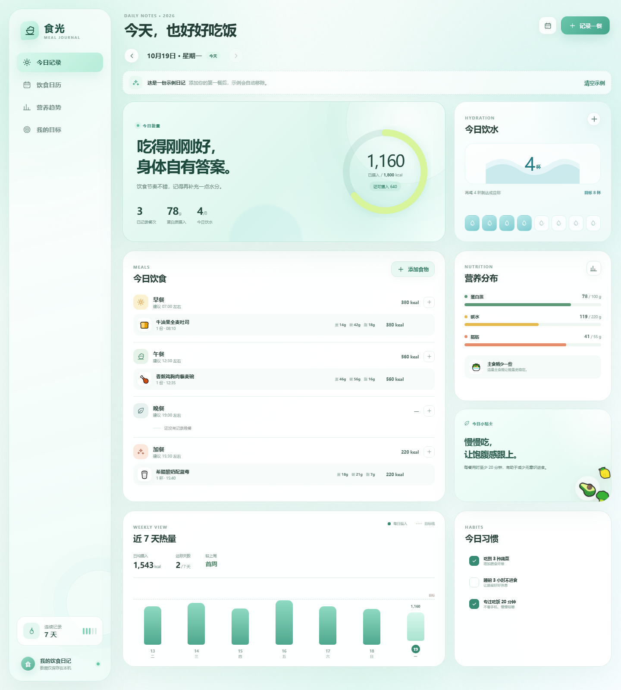
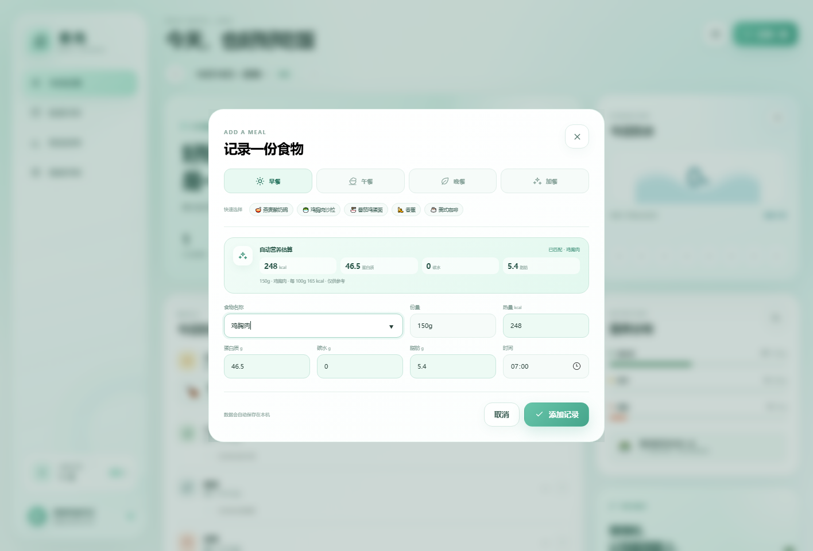
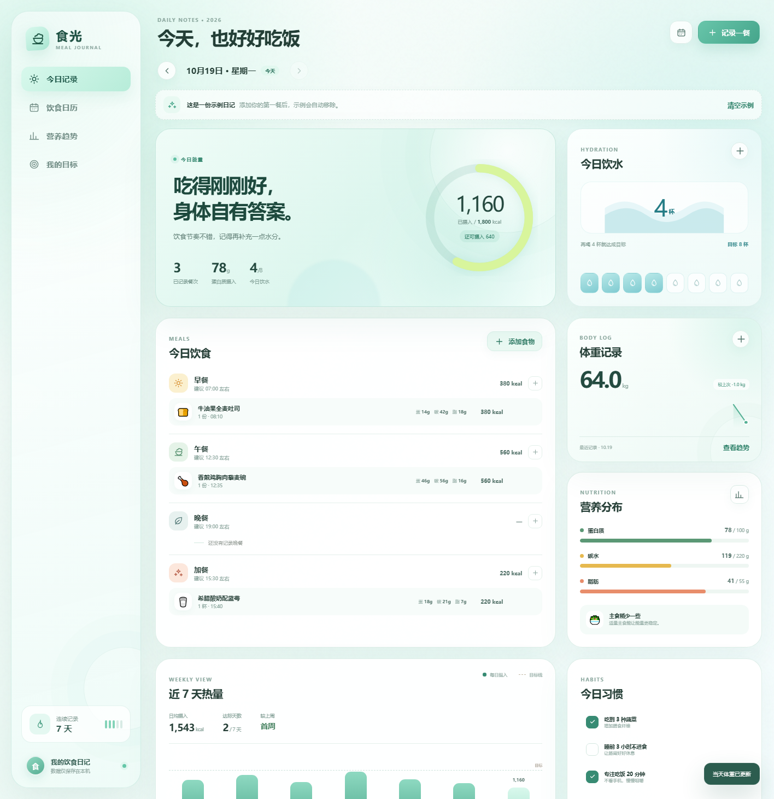
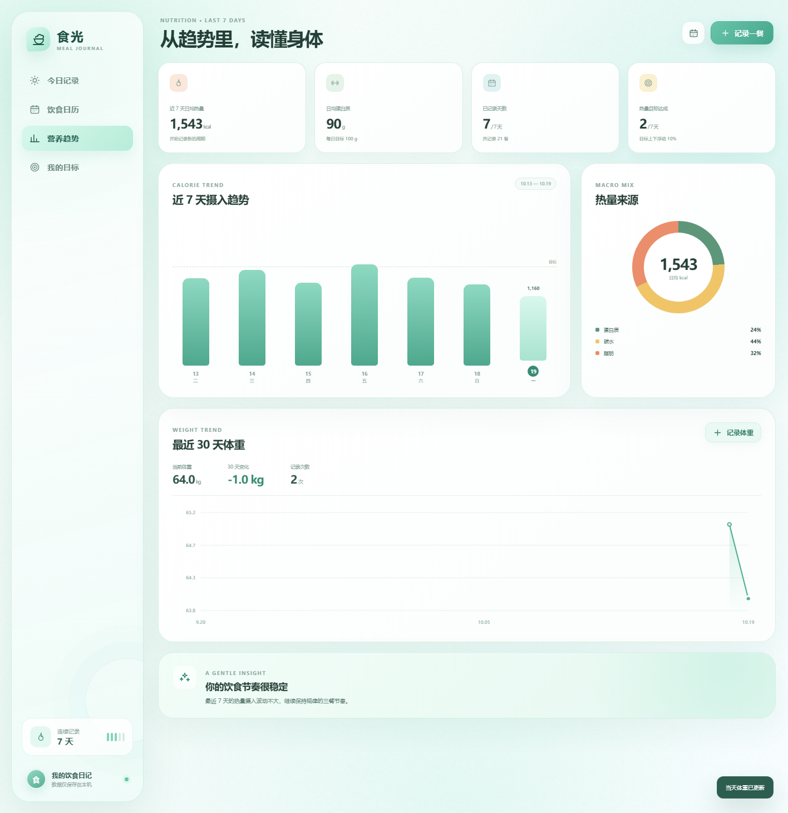

# 食光 · 个人饮食日记

**在线访问：** https://polenta0324-sketch.github.io/shiguang-meal-journal/

一个零依赖、可离线使用的个人饮食记录网站。直接打开 `index.html` 即可使用，不需要安装依赖或启动服务器。

## 主要功能

- 按日期记录早餐、午餐、晚餐和加餐
- 根据食物名称和分量自动估算热量、蛋白质、碳水与脂肪
- 自动统计热量、蛋白质、碳水、脂肪
- 每日体重记录、14 天迷你趋势与 30 天变化曲线
- 饮水杯数记录与每日目标
- 饮食日历、最近 7 天热量趋势、营养来源分析
- 自定义每日营养与饮水目标
- 食物记录的新增、编辑、删除与撤销
- 数据保存在浏览器 localStorage，支持 JSON 导出与导入
- 响应式布局，支持桌面和手机

## 自动营养估算

在记录食物时输入食物名称和分量，例如“鸡胸肉 150g”“米饭 1 碗”或“鸡蛋 2 个”，系统会根据内置常见食物营养库自动回填数据。

支持 `g / 克 / kg / ml / 碗 / 份 / 个 / 片 / 杯 / 根 / 勺 / 块 / 盒` 等分量单位。未收录的食物会按同类食物均值估算，并标记为“同类估算”；所有结果都可以在保存前手动修正。

> 内置营养数据为常见值估算，不同品牌、烹饪方式和实际份量会造成差异，结果仅供参考。

## 体重记录

在今日页点击“体重记录”卡片右上角的加号即可记录。同一天再次记录会覆盖当天数据，趋势页会展示最近 30 天的体重变化。

## 使用说明

首次打开会显示一份示例日记。添加第一餐后，示例数据会自动清空；也可以在页面中手动清空示例。

日历、趋势和目标页可以通过地址直接打开：

- `index.html?view=calendar`
- `index.html?view=trends`
- `index.html?view=goals`

## 文件

- `index.html`：页面结构
- `styles.css`：视觉样式与响应式布局
- `app.js`：本地数据、统计和交互逻辑

> 饮食与营养数据仅用于日常记录，不替代专业医疗或营养建议。
